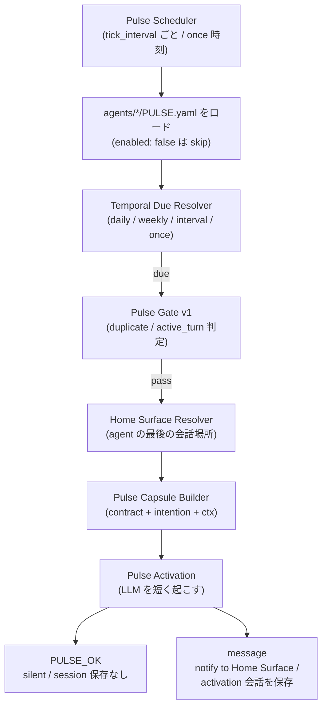
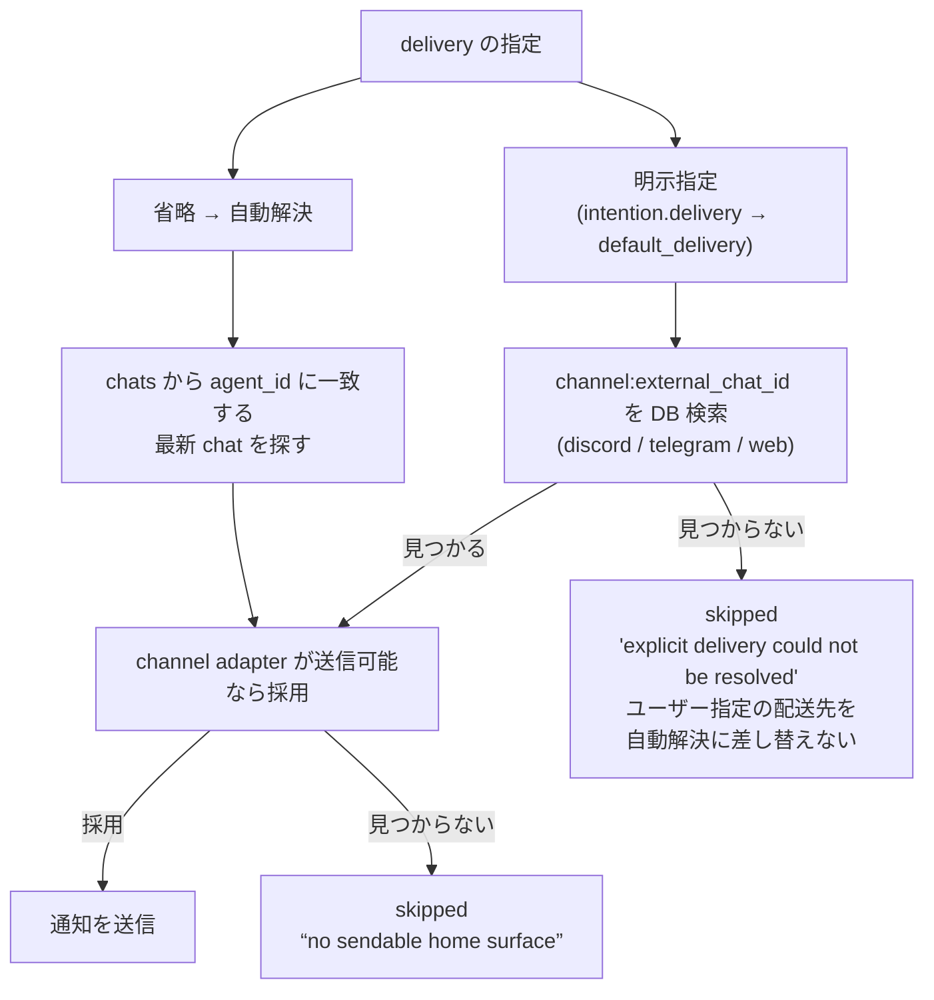

# EgoPulse Pulse 仕様

Pulse（注意活性化機構）の仕様。時間・外界・記憶からの signal を「いま意識へ上げるべきもの」として選び、必要な agent を短く活性化する。

## 目次

1. [全体思想](#1-全体思想)
2. [最小フロー](#2-最小フロー)
3. [ファイル責務](#3-ファイル責務)
4. [Temporal Intention 仕様](#4-temporal-intention-仕様)
5. [Due Resolver](#5-due-resolver)
6. [Pulse Gate v1](#6-pulse-gate-v1)
7. [Home Surface Resolver](#7-home-surface-resolver)
8. [Pulse Capsule](#8-pulse-capsule)
9. [出力・保存仕様](#9-出力保存仕様)
10. [DB 仕様](#10-db-仕様)
11. [Sleep Scheduler との分離方針](#11-sleep-scheduler-との分離方針)
12. [将来の展望](#12-将来の展望)
13. [関連ドキュメント](#13-関連ドキュメント)

---

## 1. 全体思想

### 1.1 Pulse の定義

**Pulse は、EgoPulse における Attention Activation Layer である。**

時間・外界・記憶・将来的な State から発生する signal を受け取り、**いま意識へ上げるべきもの**を選び、必要な agent を短く活性化する。signal source は現行では **Temporal Intention** のみ（最小フローは §2、将来の拡張点は §12）。

Pulse の本質は次の一文に集約される。

```text
時間条件を持つ intention が due になったとき、
その agent の注意を Pulse Capsule で短く活性化し、
必要がなければ黙り、
必要なときだけ普段の会話場所で声を出す。
```

その声（と実行文脈）だけが通常 session に残る。

### 1.2 Sleep / Pulse / Turn の関係

| 概念 | 役割 | 主な入力 | 主な出力 |
|---|---|---|---|
| 通常 Turn | ユーザー入力への応答 | 会話メッセージ | 応答・ツール実行 |
| Sleep Batch | 経験を長期記憶へ畳む | 会話履歴・記憶ファイル | episodic / semantic memory |
| Pulse | 注意を活性化する | 時間・記憶・signal | PULSE_OK / 通知 |

### 1.3 Pulse の第一原則

1. **Gate を通過したときだけ LLM を呼ぶ**
   due 判定・重複排除・active turn defer を通過した Pulse が Activation の対象になる。

2. **Cron ではなく Temporal Intention として扱う**
   「09:00 に X を実行する」ではなく、「09:00 に X へ注意を向ける」。

3. **Pulse は agent 単位で動く**
   Pulse は agent 単位の機構であり、channel 単位ではない。

4. **出力は普段の会話場所に出す**
   Pulse の結果は、その agent が普段会話している surface に出す。

5. **実行は Pulse Capsule で行う**
   Pulse の内部 prompt / contract は Capsule 内に閉じる。

6. **保存は通知経路の activation 会話だけ**
   ユーザーに見えた通知本文とその実行文脈（synthetic input・tool phase）を通常 session に残す。

7. **State は将来構想として残す**
   Trait は静的傾向、State は将来的な動的内的状態。現行の signal source は Temporal Intention のみ（§12）。

---

## 2. 最小フロー



---

## 3. ファイル責務

### 3.1 `PULSE.yaml`

Pulse は agent 配下の `PULSE.yaml` を使う。

```text
~/.egopulse/
└── agents/
    └── {agent_id}/
        ├── SOUL.md
        ├── AGENTS.md
        ├── PULSE.yaml
        └── memory/
            ├── episodic.md
            └── semantic.md
```

ファイルは純粋な YAML ドキュメントである。

```yaml
enabled: true
default_delivery:
  channel: discord
  external_chat_id: "1234567890123456789"
intentions:
  - id: morning_review
    schedule:
      kind: daily
      at: "09:00"
    attention: |
      今日の予定、未解決事項、昨日から持ち越している設計論点を確認する。
    delivery:
      channel: telegram
      external_chat_id: "987654321"
  - id: weekly_reflection
    schedule:
      kind: weekly
      day: sun
      at: "21:00"
    attention: |
      週の振り返り。
```

| 領域 | 役割 |
|---|---|
| `enabled` | agent 単位の Pulse 有効化スイッチ（省略時 `true`）。`false` のとき scheduler はその agent を skip し、`pulse` ツールは `list` / `enable` のみ応答する |
| `default_delivery` / `intentions` | 非LLMで due 判定するための構造化 Temporal Intention |
| binary embedded contract | Pulse の内部契約・安全制約・出力契約 |

Pulse 定義に version フィールドは存在しない。runtime が書き込むファイルは常に自力でパースできることが保証される（[§3.3](#33-agent-による-pulse-操作pulse-ツール)）。

`PULSE.yaml` に内部仕様を詰め込まない。
Pulse の内部契約はバイナリ側に埋め込む。

### 3.2 Config

`egopulse.config.yaml` には runtime 設定だけを置く。Pulse の有効 / 無効は agent 単位（`PULSE.yaml` の `enabled`）でのみ制御する。Pulse は常設の runtime 機能であり、scheduler の tick ループは常に回る。

```yaml
pulse:
  tick_interval: "1m"
```

| 設定 | 役割 |
|---|---|
| `pulse.tick_interval` | due scan の基本周期（Duration 形式: `30s`, `1m`, `1h`。デフォルト `1m`）。`once` の次回発火がこの周期内にある場合、scheduler はその時刻に起床する |

due 判定の timezone はトップレベルの `timezone`（[config.md](./config.md)）を使用する。

Temporal Intention の中身は config に置かない。
それは agent の注意方針なので、`agents/{agent_id}/PULSE.yaml` に置く。

### 3.3 Agent による Pulse 操作（`pulse` ツール）

Pulse の設定は built-in ツール `pulse` を通じてのみ行う。エージェントは会話の中で「毎日 9時にこれを確認して」「明日の 10時にリマインドして」と言われると、このツールで intention を設定する。ファイルへの書き込みはすべてツール経由とし、エージェントが PULSE.yaml を直接 write/edit することはない。

実装は [`src/tools/pulse.rs`](../src/tools/pulse.rs)。ツール description がエージェント向け Pulse 知識の唯一の正本であり、system prompt や skill には Pulse 専門セクションを設けない。

| op | 引数 | 動作 |
|---|---|---|
| `list` | — | 現在の設定を表示。各 intention の schedule・enabled・次回発火見積もり、agent の enabled 状態。パースエラー（手編集による破損）もここで報告される |
| `add` | `schedule` + `attention`、`id` / `delivery` は省略可 | intention を作成。`id` 省略時は schedule から自動採番（重複時は接尾辞）。`delivery` 省略時は**現在の会話**が使われる（チャネルが Discord / Telegram / Web の場合。Web は現在のセッション ID `chat:{id}`）。`once` は未来日のみ可 |
| `update` | `id` + `schedule` / `attention` / `delivery` | intention を変更 |
| `remove` | `id` | intention を削除 |
| `enable` / `disable` | `id` 省略可 | `id` あり: その intention のON/OFF。`id` なし: agent レベルの `enabled` 切替 |

挙動の固定ルール:

| ルール | 内容 |
|---|---|
| バリデーションエラー | ツールエラー文字列として返る（`HH:MM` 不正、id 重複、`interval_days < 1`、曜日不正、非対応チャネル等）。エージェントは会話の中で自己修正できる |
| Secret 会話 | 呼び出しはエラー。Pulse の実行・配送は Normal スコープで行われるため、設定は通常の会話から行う |
| 書き込み | serialize → parse round-trip → atomic rename。ツールが書いたファイルがパースできない状態は原理的に発生しない |
| 並行書き込み | load → 変更 → save をプロセス共通の排他ゲート内で直列化。複数 turn や activation 後のアーカイブが同時に走っても更新消失・破損はしない |
| `add` の配送先デフォルト | 現在の会話。送信可能チャネル以外（TUI / CLI）で頼まれた場合は、Discord / Telegram / Web の配送先を問い返してから intention を作成する。Web はセッション ID `chat:{id}` |
| 同日の再発火 | daily の `due_key` は日付単位のため、発火済みの日に時刻を変更しても当日は再発火しない（§5.2）。再発火させたい場合は id を変える |
| 発火見込みの表示 | scheduler と同じ判定。時刻到達かつ未実行は `due now (pending next scan)`、実行済み期間は `already attempted for current period`（`interval` は翌日の時刻を次回発火として示す）、`once` 実行済みは `already attempted (no automatic retry)`。無効な agent・intention には表示しない。実行履歴の参照に失敗した場合は該当行に `error`、`list` 全体はツールエラー |
| `once` の自動アーカイブ | 成功時に PULSE.yaml から除去する。失敗・skipped・activation 中の変更時の扱いは §4.4 |
| 操作対象 | 自 agent の PULSE.yaml のみ。将来の委譲拡張は `agent_id` 引数の追加 |
| 反映 | 次の tick で反映。再起動不要。保存が成功すると scheduler へ起床信号が送られるため、`once` を追加した場合も次の tick を待たずに指定時刻へ起床する |
| Activation 中の自己編集 | 許可。activation が active turn を保持するため、通常 turn との書き込み競合は発生しない |

---

## 4. Temporal Intention 仕様

対応する schedule は以下の 4 種類。

### 4.1 daily

```yaml
schedule:
  kind: daily
  at: "09:00"
```

### 4.2 weekly

```yaml
schedule:
  kind: weekly
  day: sun
  at: "21:00"
```

### 4.3 interval

`interval_days` 日ごとに発火する。起点は**前回成功した発火日**（`pulse_runs.status = success` の最新 `started_at`）。

```yaml
schedule:
  kind: interval
  interval_days: 3
  at: "09:00"
```

`daily` / `weekly` がカレンダー期間固定の絶対基準であるのに対し、`interval` は**意図の達成（=成功）を起点とする相対基準**である。この違いにより、失敗時の扱いが異なる。

#### 失敗時の挙動（意図駆動リトライ）

前回成功日を起点にするため、失敗しても起点は更新されず、`interval_days` 経過後は**成功するまで毎日再評価される**。ただし `due_key` が評価日単位で進むため、1 日 1 回まで（翌日リトライ）。

| 日付 | 状態 | due | 備考 |
|---|---|---|---|
| 07/03 | 成功 | — | `last_success = 07/03` に更新 |
| 07/04〜05 | skip | ✗ | `07/03 + 3日 = 07/06` 未到 |
| 07/06 | 発火→**失敗** | ✓ | `last_success` は更新されず `07/03` のまま |
| 07/07 | 発火→成功 | ✓ | `due_key` が 07/07 に進むため再試行可能 |
| 07/08〜09 | skip | ✗ | `07/07 + 3日 = 07/10` 未到 |
| 07/10 | 発火 | ✓ | — |

初回（`last_success = None`）は時刻判定のみで due になる。

### 4.4 once

指定した日付の `at` に 1 回だけ発火する単発リマインダ。

```yaml
schedule:
  kind: once
  date: "2026-05-12"
  at: "18:00"
```

- `add` 時に `date + at` が過去のものは拒否される（ツール経由の場合）。タイムゾーンの DST 移行で存在しないローカル時刻も同様に拒否される
- 発火は対象日の `at` **ちょうど**（秒精度）に行われる。`once` は予約型リマインダであり、時刻そのものが意味を持つため、scheduler は `tick_interval` を待たずに次回 due 時刻へ起床する（[§3.2](#32-config)）
- **成功した run の後に intention は自動アーカイブされる**（PULSE.yaml から除去される）。単発リマインドが設定の残余を残さないため。activation 中に内容が変更されていた場合はアーカイブせず変更後の定義を残す
- 失敗・skipped の場合は intention はファイルに残る。`due_key` は対象日を消耗するため自動リトライはせず、エージェントが `list` で検知して会話的に再設定する

### 4.5 validation

| 項目 | 仕様 |
|---|---|
| `enabled`（document） | `true` / `false`。省略時 `true`。`false` のとき scheduler はその agent を skip する |
| `id` | agent 内で一意 |
| `enabled`（intention） | `true` / `false`。省略時 `true`。`false` のときその intention の due 判定・実行をスキップする |
| `schedule.kind` | `daily` / `weekly` / `interval` / `once` |
| `daily.at` | `HH:MM` |
| `weekly.day` | `mon`〜`sun` |
| `weekly.at` | `HH:MM` |
| `interval.interval_days` | `1` 以上の整数 |
| `interval.at` | `HH:MM` |
| `once.date` | `YYYY-MM-DD` |
| `once.at` | `HH:MM` |
| `attention` | LLM に渡す注意対象。実行命令ではない |
| `default_delivery` | 省略可能。agent レベルのデフォルト配送先 |
| `default_delivery.channel` | `discord` / `telegram` / `web` |
| `default_delivery.external_chat_id` | 空不可。`web` の場合は WebUI のセッション ID `chat:{id}` |
| `delivery`（intention 内） | 省略可能。`default_delivery` をオーバーライド |
| `delivery.channel` | `discord` / `telegram` / `web` |
| `delivery.external_chat_id` | 空不可。`web` の場合は WebUI のセッション ID `chat:{id}` |

`attention` は `task` ではない。
「この時間に、この対象へ注意を向ける」という意味を持つ。

---

## 5. Due Resolver

Temporal Intention が due かどうかを非LLMで判定する。

### 5.1 判定ロジック

```text
daily:
  今日の日付 + at <= now
  かつ due_key 未実行

weekly:
  今日の曜日 == day
  かつ 今日の日付 + at <= now
  かつ due_key 未実行

interval:
  今日のローカル日付 >= 前回成功日 + interval_days
  かつ 今日の日付 + at <= now
  かつ due_key 未実行
  ※ 前回成功日 = pulse_runs.status='success' の最新 started_at
  ※ 前回成功日が無い（初回）場合は日付条件をスキップ（時刻判定のみ）

once:
  今日のローカル日付 == date
  かつ 今日の日付 + at <= now
  かつ due_key 未実行
```

### 5.2 due_key

重複実行防止のため、各 intention から `due_key` を作る。形式は `{agent_id}:{intention_id}:{期間キー}`。

| schedule | due_key 例 |
|---|---|
| daily | `lyre:morning_review:2026-05-10` |
| weekly | `kitara:weekly_reflection:2026-W19` |
| interval | `lyre:periodic_report:2026-05-10` |
| once | `lyre:dentist_reminder:2026-05-12`（設定日固定） |

`interval` の `due_key` は評価日（今日のローカル日付）。前回成功日ではない。これにより、失敗した日は `due_key` が消費され、翌日は別の `due_key` で再評価される（意図駆動リトライ）。

`once` の `due_key` は設定日固定。最初の run（status によらず）が消費するため、失敗時に同一日の再発火はしない。再設定は `remove` → `add` で行う（[§3.3](#33-agent-による-pulse-操作pulse-ツール)）。

---

## 6. Pulse Gate v1

Gate の役割は「起こすべきでないものを確実に落とす」こと。

```text
Pulse Gate v1 =
  due である
  かつ due_key が未実行
  かつ agent が active turn 中ではない
```

判定結果は以下の 3 つ。

| 判定 | 意味 | 挙動 |
|---|---|---|
| `Allow` | 実行してよい | run 作成 → activation へ進む |
| `Duplicate` | 同一 `due_key` の run が既にある | 何もしない |
| `DeferActive` | agent が active turn 中 | 何もしない。`due_key` は消費しないため次 tick で再評価される |

---

## 7. Home Surface Resolver

### 7.1 目的

Pulse は agent 単位で発火するが、結果はその agent が普段会話している場所へ出したい。そこで、agent が Pulse の結果を出す標準の会話場所 **Home Surface** を解決してから通知する。

### 7.2 解決ルール



| ケース | 動作 |
|---|---|
| 明示指定・`web` 以外 | ユーザー指定の生の external chat ID を session-key 形式 `{channel}:{external_chat_id}:agent:{agent_id}` に変換して照合する |
| 明示指定・`web` | WebUI のセッション ID `chat:{id}` で解決し、`channel` が `web`・`agent_id` が対象 agent と一致することを検証する（`chat_id` は DB 全体で一意。検証がないと他 agent のセッションへ配送できる） |
| 送信可能 channel | Discord / Telegram / Web。CLI / TUI / Voice は対象外 |
| Web が無効な runtime | 明示指定・自動解決とも `skipped` |
| Web への配送 | 通常 session への永続化そのもの。リアルタイム通知は `session_updated` と履歴ポーリング。未開封の通知は保存され、次に開いたときに表示される（OS push はしない） |
| Activation のコンテキスト | Home Surface の `external_chat_id`（session key 形式）から生の `surface_thread` を復元して構築。Activation 中の `agent_send` は宛先の通常 session key（`{channel}:{surface_thread}:agent:{to}`）を解決できる |
| どれも解決できない | run を `skipped` として記録（LLM は呼ばない） |

### 7.3 注意点

Pulse 通知を通常 session に保存すると、その chat の `last_message_time` は更新される。
そのため、一度 Pulse が発話した chat は Home Surface として維持されやすい。

ユーザーが別の場所で同じ agent と会話すれば、その chat が新しい Home Surface になる。

Web の自動解決は、WebUI でアーカイブされたセッションも候補に含む。アーカイブは一覧表示の制御であり履歴・配送は保持されるため、配送先を変えたい場合は intention の `delivery` に別の会話を明示するか、Pulse を無効化する。

---

## 8. Pulse Capsule

Pulse Activation は通常 session の messages の代わりに、専用の **Pulse Capsule** を構築する。

### 8.1 構成

```text
Pulse Capsule =
  binary embedded contract
  + due になった Temporal Intention
  + Home Surface の軽量 recent context
```

LLM 呼び出しは以下の 2 つから構成される。

- **system prompt**: 通常セッションと同じ構成（SOUL / Core Instructions / AGENTS / Long-term Memory / Skills catalog）
- **user message**: 以下の Pulse Capsule

```text
# Pulse Activation

agent_id: lyre
intention_id: morning_review
trigger: temporal_due
home_surface:
  channel: discord
  external_chat_id: "1234567890123456789"
now: 2026-05-10T09:00:00+09:00

## Core Contract

{binary embedded Pulse Core Contract}

## Temporal Intention

{intention の attention}

## Recent Visible Context

{Home Surface の直近 user-visible messages（最大10件）}
```

| 要素 | 入れる |
|---|---|
| binary embedded Pulse Contract | 入れる |
| due intention | 入れる |
| Home Surface の直近メッセージ | 最大10件入れる |
| 通常 session 全文 | 入れない |
| tool call 履歴全体 | 入れない |
| 過去 Pulse の全文 | 入れない |

Core Contract は `include_str!` で `pulse_core_contract.md` をバイナリに埋め込む。内容は「注意活性化モードであること」「intention を目的として評価・充足すること」「通知する価値がなければ `PULSE_OK` を返すこと」「出力に Pulse や activation の話を書かないこと」で、作業範囲は bounded scope に限定される。

`Recent Visible Context` は、ユーザーに見えている直近文脈（最大10件）を補助的に渡す。内部 snapshot は投影しない。

### 8.2 LLM 呼び出し構成

Pulse Activation は、通常セッションと**同じ system prompt をそのまま**使用する。
Pulse 固有の指示（Core Contract を含む）はすべて user message（Capsule）側に含まれる。

system prompt の構成は SOUL.md → Core Instructions → AGENTS.md → Long-term Memory（episodic / semantic）→ Skills catalog。Capsule には long-term memory を含めず、system prompt からの注入に一本化する。

この構成により:

- 通常セッションと system prompt が完全一致 → prompt cache が最大効率で hit する
- agent の人格・記憶・スキルが Pulse でも一貫して利用可能

各 LLM 呼び出しは、通常 Turn と同じ共通リトライ判定で一過性エラー（送信失敗・429・5xx）を最大 3 回まで試行する。Pulse は全エージェントを逐次スキャンするため、待機時間（サーバーの `Retry-After` を含む）が 60 秒を超えるリトライは行わず、その Activation を即座に `failed` とする。これによりプロバイダのクォータ枯渇時に後続の Pulse が止まらない。

Pulse の生成途中の delta は破棄し、外部公開済み出力として扱わない。途中でストリームが中断しても同じ LLM 呼び出しを再試行でき、最終応答が空の場合も共通の runtime guard による回復を行う。通常 Turn は delta を外部公開した時点で再試行を抑止する。いずれも実行済み Tool や Activation 全体を再実行しない。

### 8.3 Tools

Home Surface が Multi-Agent Room の場合、共有 Channel Log を解決または作成し、その ID を Tool 実行と `agent_send` の宛先 Turn へ引き継ぐ。`agent_send` の公開メッセージは共有 Log、宛先の直接入力と内部イベントは宛先 Agent Session に保存する。Single-Agent Channel では Home の Agent Session を保存先とする。

Pulse Activation は通常 turn と同じく built-in tools + MCP tools を使用可能。tool loop を最大 50 イテレーション回し、48回目に終了警告を付け、49〜50回目は最終回答を優先する指示を追加する。activation 全体は 30 分のタイムアウトで保護され、タイムアウト・パニック時は run を `failed` として記録する。

activation 中も `active_turn` を保持するため、その間の通常 turn / 他 Pulse は defer される。

---

## 9. 出力・保存仕様

### 9.1 出力種別

Pulse の出力は 2 種類だけ。

| 出力 | 意味 | 動作 | `output_kind` |
|---|---|---|---|
| `PULSE_OK` | 通知不要 | silent として記録。通常 session には何も保存しない | `silent` |
| その他の本文 | 通知あり | Home Surface へ送信し、通常 session に保存する（Web では保存そのものが配送） | `notify` |

`PULSE_OK` は case-insensitive で前後空白を trim して判定する（空文字も silent 扱い）。

### 9.2 通知本文の保存

通知本文が出た場合、Pulse Activation の会話を通常 session に保存する。

```text
1. synthetic user message（intention の構造化文脈）
   [Pulse: {intention_id}]
   Schedule: {schedule}
   Attention:
   {attention}
   - Schedule は `daily 08:00`, `weekly sun 21:00`, `every 3 days 09:00` の形式
   - Attention は PULSE.yaml の intention 定義そのまま
   - sender は `pulse`、message_kind は `SystemEvent`

2. tool phase（あった場合）
   assistant message + tool messages を順に保存

3. 最終 assistant message
   通知本文を保存
```

これにより、ユーザーは Pulse 通知にそのまま返信できる。

```text
リラ:
昨日の Pulse 設計で、まだ Home Surface の扱いが未確定です。
ここを固めると仕様がかなり安定しそうです。

User:
それもう少し深掘りして
```

この返信は通常 Turn として処理される。
直前の Pulse 通知が通常 session に残っているため、自然に文脈がつながる。

### 9.3 通常 session に残すもの / 残さないもの

| 内容 | 通常 session に保存 | 理由 |
|---|---|---|
| `PULSE_OK` | しない | ユーザーに見えていないため |
| Pulse 内部 contract | しない | 通常会話を汚すため |
| Pulse Capsule 全文 | しない | 内部実行文脈のため |
| due intention の内部 prompt | しない | 通常会話に不要 |
| synthetic input（通知本文の文脈） | する | 返信時に文脈を引き継ぐため |
| tool phase（通知までの実行文脈） | する | 返信時に文脈を引き継ぐため |
| 通知本文 | する | ユーザーに見えた発言だから |
| run metadata | `pulse_runs` に保存 | 監査・重複防止用 |
| due_key | `pulse_runs` に保存 | 再実行防止用 |

この方針により、**ユーザー体験としては通常会話に見えつつ、内部文脈は通常 session を汚さない**。

### 9.4 Output / Execution / Storage の分離

| 領域 | 方針 |
|---|---|
| 実行 | Pulse Capsule で実行する |
| 出力 | 普段の会話場所、つまり Home Surface に出す |
| 保存 | 通知経路の activation 会話だけ、通常 session に保存する |

---

## 10. DB 仕様

### 10.1 `pulse_runs` テーブル

```sql
CREATE TABLE pulse_runs (
    id            TEXT PRIMARY KEY,
    agent_id      TEXT NOT NULL,
    intention_id  TEXT NOT NULL,
    due_key       TEXT NOT NULL,

    chat_id       INTEGER,
    message_id    TEXT,

    status        TEXT NOT NULL,
    started_at    TEXT NOT NULL,
    finished_at   TEXT,
    output_kind   TEXT,
    output_text   TEXT,
    error_message TEXT,
    attention_snapshot TEXT
);

CREATE UNIQUE INDEX idx_pulse_runs_due
    ON pulse_runs(agent_id, intention_id, due_key);

CREATE INDEX idx_pulse_runs_agent_started
    ON pulse_runs(agent_id, started_at);

CREATE INDEX idx_pulse_runs_chat_id
    ON pulse_runs(chat_id);
```

### 10.2 カラム責務

| カラム | 役割 |
|---|---|
| `id` | pulse run ID |
| `agent_id` | 対象 agent |
| `intention_id` | due になった intention |
| `due_key` | 重複実行防止 |
| `chat_id` | 通知先の通常 chat。silent の場合 null |
| `message_id` | 保存した assistant message ID。silent の場合 null |
| `status` | running / success / failed / skipped |
| `output_kind` | silent / notify |
| `output_text` | LLM 出力。通知した本文または PULSE_OK |
| `error_message` | 失敗時の詳細、または skip 理由 |
| `attention_snapshot` | run 開始時点の attention。PULSE.yaml がその後変わっても、その run が何に注意を向けたかを示す |

`status = skipped` になるのは、送信可能な Home Surface が解決できなかった場合（LLM は呼ばれない）。

---

## 11. Sleep Scheduler との分離方針

Sleep（記憶変換バッチ）と Pulse（注意活性化）は同じ scheduler 系ではあるが、別ドメインとして分離する。

### 11.1 実装構成

```text
src/
├── sleep/                   # Sleep scheduler と処理本体
│   ├── scheduler.rs         # Sleep scheduler
│   ├── orchestrator.rs      # Sleep Batch 実行
│   └── ...                  # episodic_renderer / event_rollup / memory_update
├── tools/pulse.rs           # `pulse` ツール（agent による PULSE.yaml 操作・§3.3）
└── pulse/                   # Pulse scheduler と処理本体
    ├── scheduler.rs         # Pulse scheduler（tick / due / gate / home surface / once archive）
    ├── capsule.rs           # Gate 判定・Capsule 構築・Home Surface 解決
    ├── definition.rs        # PULSE.yaml パース・検証・保存・due 判定・due_key 生成
    ├── runner.rs            # LLM activation（tool loop）
    ├── output.rs            # 出力処理（silent / notify・session 保存）
    ├── pulse_core_contract.md
    └── mod.rs
```

### 11.2 共通化するもの

| 共通化 | 内容 |
|---|---|
| timezone helper | now / local date / due 判定補助 |
| active_turn defer | agent active 中は defer |
| shutdown 連動 | runtime 停止時に scheduler も止まる |
| retry utility | Turn / Pulse / Sleep / Compaction / ask で試行回数・バックオフ・`Retry-After` の扱いを揃える（Pulse は待機時間に上限あり） |

### 11.3 分けるもの

| 分離 | 理由 |
|---|---|
| Sleep 本体 | memory 書き換え処理だから |
| Pulse 本体 | attention activation だから |
| DB schema | `sleep_runs` と `pulse_runs` は責務が違う |
| prompt / capsule | LLM に求める役割が違う |
| 出力処理 | Sleep は基本 silent、Pulse は Home Surface 出力あり |

---

## 12. 将来の展望

signal source は将来の拡張に備えて、pipeline の先頭へ接続する形を維持する。将来の signal source:

- ExternalEvent（Webhook / GitHub / SwitchBot 等の外界 signal）
- ProspectiveDue（意向ベースの due）
- MemoryResurfaced（記憶の再浮上）
- StateShift（agent の内的状態の変化。State は未実装。Trait は静的な性格傾向）
- AutonomousCuriosity（内発的な探索 signal）
- 通知は Home Surface への Inline Output のみ。将来の Notification Router（`silent` / `log_only` / `pulse_inbox` / `notify` / `urgent` / `approval_required`）と multi-agent 構成での inbox 調律は拡張方向として残す

---

## 13. 関連ドキュメント

| 項目 | 正本 |
|---|---|
| DB スキーマ（`pulse_runs` テーブル） | [db.md](./db.md) |
| 設定（`pulse` セクション・`timezone`） | [config.md §3.8](./config.md#38-pulse-設定pulse) |
| Sleep Batch（Scheduler 分離の相手） | [sleep.md](./sleep.md) |
| WebUI の Schedule 画面 | [webui/schedule.md](./webui/schedule.md) |
